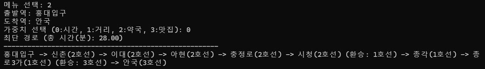
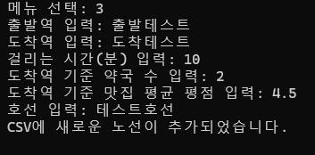
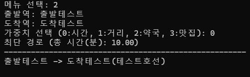
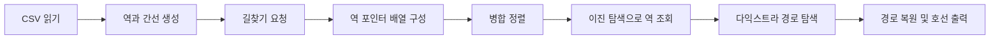

# Metro Map | C 기반 지하철 경로 탐색

**2025년 1학기, 대학교 2학년 자료구조 과목의 개인 기말 프로젝트**로 구현한 콘솔 프로그램입니다.
CSV에서 읽은 역과 노선 정보를 그래프로 구성하고, 출발역과 도착역 사이의 경로를 탐색합니다.

연결 리스트, 그래프, 병합 정렬, 이진 탐색, 다익스트라 알고리즘을 하나의 프로그램 안에서 연결해 적용했습니다.

**기술:** C · 표준 파일 입출력 · 동적 메모리 할당 · Visual Studio 프로젝트

**개발 형태:** 개인 프로젝트 — 노선 데이터 처리, 자료구조 및 알고리즘 구현, 콘솔 인터페이스 구성

## 개발 목적

수업에서 배운 자료구조와 알고리즘을 지하철 길찾기 문제에 적용하는 것을 목표로 했습니다. 역 사이의 관계를 그래프로 모델링하고, 사용자가 출발역·도착역과 탐색 기준을 선택하면 경로를 출력하도록 구성했습니다.

시간과 거리뿐 아니라 역 주변의 약국 수와 맛집 평점도 탐색 기준으로 활용해 보고자 했습니다. 또한 노선 정보를 CSV로 분리해 파일을 불러오거나 콘솔에서 연결 정보를 추가할 수 있도록 했습니다. 이 개발 목적은 제출 보고서 1장에 정리되어 있습니다.

## 주요 기능

- **CSV 기반 노선 로딩:** 출발역, 도착역, 이동 시간, 도착역 주변 정보, 호선을 읽어 그래프를 구성합니다.
- **시간 기준 경로 탐색:** 이동 시간의 합을 비용으로 사용해 경로를 찾습니다.
- **경로 및 환승 표시:** 경유하는 역과 호선을 출력하고, 이동 호선이 바뀌는 지점에 환승을 표시합니다.
- **노선 데이터 추가:** 콘솔에서 입력한 연결 정보를 CSV 파일에 저장합니다.
- **탐색 기준 확장 실험:** 시간 외에 환산 거리, 약국 수, 맛집 평점 기준을 선택할 수 있도록 구현했습니다. 각 기준의 제약은 아래에 설명합니다.

## 제출 당시 실행 화면

아래 이미지는 기말 보고서 22~23쪽의 실행 캡처를 추출한 것입니다. 제출 당시의 동작 기록이며, 현재 환경에서 새로 실행한 결과는 아닙니다.

### 시간 기준 길찾기와 환승 표시

홍대입구에서 안국까지 탐색한 화면입니다. 입력 데이터 기준 총 28분으로 출력되며, 시청에서 1호선으로, 종로3가에서 3호선으로 갈아타는 경로를 보여줍니다.



*출처: 제출 보고서 22쪽, 그림 23 「길찾기 – 시간」.*

### 노선 추가와 추가한 구간 탐색

`출발테스트 → 도착테스트` 구간을 10분으로 입력해 CSV에 추가한 화면과, 해당 구간을 탐색한 결과입니다. 추가한 데이터는 CSV를 다시 불러온 뒤 그래프에 반영됩니다.





*출처: 제출 보고서 23쪽, 그림 27 「CSV 파일 수정 – 역 추가」 및 그림 28 「실제 추가되는지 테스트 출력」.*

## 자료구조와 알고리즘 적용

| 요소 | 구현 방식 | 프로그램에서의 역할 |
| --- | --- | --- |
| 역 목록 | `Station` 구조체의 연결 리스트 | 역 이름, 주변 정보, 연결 간선 보관 |
| 노선 그래프 | `Edge` 연결 리스트를 이용한 인접 리스트 | 연결된 역, 이동 시간, 환산 거리, 호선 저장 |
| 병합 정렬 | 역 포인터 배열을 `strcmp` 기준으로 정렬 | 이진 탐색을 위한 역 이름 순서 구성 |
| 이진 탐색 | 정렬된 배열에서 역 이름 검색 | 출발역·도착역 및 인접 역의 배열 인덱스 조회 |
| 다익스트라 | 미방문 역 중 최소 비용 역을 배열 순회로 선택 | 이동 비용 누적 및 이전 역 기록 |
| 경로 복원 | `prev` 배열을 도착역부터 역추적 | 출발역부터 도착역까지 순서대로 출력 |

### 데이터 처리 흐름



역과 간선은 연결 리스트로 보관하고, 경로를 탐색할 때 역 포인터 배열을 만들어 정렬합니다. 같은 역 정보를 복제하지 않고 포인터를 통해 참조하며, 정렬된 배열에서 이름으로 역을 찾습니다.

### 설계에서 고려한 점

- **역 정보와 연결 정보 분리:** 역 이름과 주변 정보는 `Station`에, 목적지·소요 시간·호선은 `Edge`에 저장했습니다. `Metro`는 전체 역 리스트의 시작점을 관리합니다. (보고서 2장)
- **역 포인터 배열 정렬:** 병합 정렬에서 `Station` 구조체 전체 대신 포인터를 이동시킵니다. 정렬은 화면에 역 목록을 보여주기 위한 것이 아니라 이진 탐색을 위한 전처리이며, 정렬과 검색에 같은 `strcmp` 비교 기준을 사용합니다. (보고서 5장)
- **정렬 시점:** CSV를 읽을 때가 아니라 `dijkstra()`를 호출할 때 배열 생성과 정렬을 수행합니다. 보고서 5.3절과 현재 코드의 동작을 기준으로 설명했습니다.
- **출력에 필요한 정보 보관:** `prev`에 이전 역을, `prev_line`에 도달할 때 이용한 호선을 저장해 경로를 복원하고 호선 변경을 표시합니다. (보고서 6.3절)
- **파일 저장과 그래프 반영 구분:** 노선 추가는 CSV 파일 끝에 한 행을 저장하며, 다시 로딩해야 탐색에 반영됩니다. (보고서 3.3절·7.2절)

CSV의 한 행은 **출발역에서 도착역으로 향하는 방향 간선**입니다. 반대 방향으로도 이동하려면 반대 방향의 행이 필요합니다. 같은 이름의 역은 하나의 정점으로 취급하며, 간선에 저장한 호선 정보로 환승을 표시합니다.

## 실행 방법

저장소에 Visual Studio 솔루션과 C 소스가 포함되어 있습니다.

1. 저장소를 내려받습니다.
2. Visual Studio에서 `MetroMap/MetroMap.sln`을 엽니다. C/C++ 빌드 도구가 필요합니다.
3. 프로젝트를 빌드한 뒤 실행합니다.
4. 메뉴에서 `1. CSV 새로고침`을 선택하고 `subway.csv`를 불러옵니다.
5. `2. 길찾기`에서 출발역, 도착역, 가중치를 입력합니다. 시간 기준은 `0`입니다.

CSV 파일명은 **프로그램의 작업 디렉터리**를 기준으로 해석합니다. 기본 파일을 찾지 못하면 CSV의 전체 경로를 입력하세요. 한글 역 이름을 사용하므로 소스·CSV·콘솔의 문자 인코딩도 일치해야 합니다.

사용 흐름 예시: CSV 로딩 → 출발역 `남영` → 도착역 `종로3가` → 가중치 `0` 선택.

노선을 추가한 뒤 탐색에 반영하려면 CSV를 다시 불러와야 합니다. 현재 버전은 다시 로딩할 때 기존 그래프를 비우지 않으므로, 데이터를 수정한 후에는 프로그램을 재시작하고 로딩하는 방식을 권장합니다.

## CSV 형식

헤더 없이 다음 순서로 작성합니다.

```text
출발역,도착역,이동시간(분),도착역 약국 수,도착역 맛집 평균 평점,호선
```

저장소 데이터의 예시:

```csv
남영,서울역,2,1,4.7,1호선
서울역,시청,3,2,4.9,1호선
```

약국 수와 평점은 도착역의 속성으로 저장합니다. 같은 도착역이 여러 행에 등장하면 마지막으로 읽은 값이 적용됩니다. 포함된 CSV는 프로젝트 실행용 데이터이며, 실제 운행 시간이나 주변 시설의 최신 정보를 보장하지 않습니다.

## 구현 범위와 개선 과제

### 제출 당시 제안한 확장 방향

보고서 결론(9.2절)에서는 다음을 후속 아이디어로 제시했습니다. 현재 구현된 기능과 구분합니다.

- 콘솔 화면을 보완하는 그래픽 기반 노선·경로 시각화
- 환승 시간과 열차 도착까지의 대기 시간 반영
- 이동 시간과 주변 시설 정보를 함께 고려하는 복합 기준 탐색
- 역 삭제 및 연결 관계 갱신 기능

### 현재 코드를 검토하며 확인한 보완점

아래 내용은 포트폴리오 정리 과정에서 코드와 보고서를 대조해 추가한 검토 사항입니다.

#### 1. 탐색 기준에 맞는 비용 설계

시간 기준 탐색은 이동 시간이 음수가 아닌 경우 다익스트라의 적용 조건에 맞습니다. 현재 약국·맛집 모드는 값이 클수록 유리하도록 **음수 가중치**를 사용하고 있어, 다익스트라로 최적 경로를 보장할 수 없습니다. 따라서 이 두 모드는 탐색 기준을 확장한 실험적 구현입니다.

향후에는 이동 시간에 제한을 두고 경유 후보를 비교하는 등, 주변 정보를 반영할 목적과 제약을 먼저 정의한 뒤 탐색 방식을 재설계할 수 있습니다.

#### 2. 시간과 거리의 구분

거리는 실제 역간 거리가 아니라 `시간 × 30km/h ÷ 60`으로 환산합니다. 모든 구간에 같은 속도를 사용하므로 시간과 거리 기준의 최적 경로 집합은 같습니다. 서로 다른 기준으로 활용하려면 실제 거리 데이터를 별도로 저장해야 합니다.

#### 3. 환승 비용과 데이터 관리

현재는 호선 변경을 표시하며, 환승 대기 시간이나 환승 횟수는 비용에 포함하지 않습니다. CSV 재로딩 시 기존 그래프 해제, 역별 주변 정보의 일관성 검사, 입력값 및 최대 역 수 검증도 후속 개선 과제입니다.

## 주요 파일

| 파일 | 내용 |
| --- | --- |
| [MetroMap.c](MetroMap/MetroMap.c) | 그래프 구성, 정렬·검색, 경로 탐색, 콘솔 메뉴 |
| [subway.csv](MetroMap/subway.csv) | 노선 및 역 주변 정보 |
| [MetroMap.sln](MetroMap/MetroMap.sln) | Visual Studio 솔루션 |
| [기말 프로젝트 보고서](Metro%20%EA%B8%B0%EB%A7%90%EA%B3%BC%EC%A0%9C%20%EB%B3%B4%EA%B3%A0%EC%84%9C.pdf) | 과제 제출 보고서 |

이 README는 제출 보고서 전체 24쪽과 저장소의 C 소스·CSV를 함께 검토해 정리했습니다. 보고서는 당시의 개발 목적과 설계 설명, 실행 기록의 근거로 사용했으며, 기능의 동작 시점과 제약은 현재 코드에 맞춰 기술했습니다.
